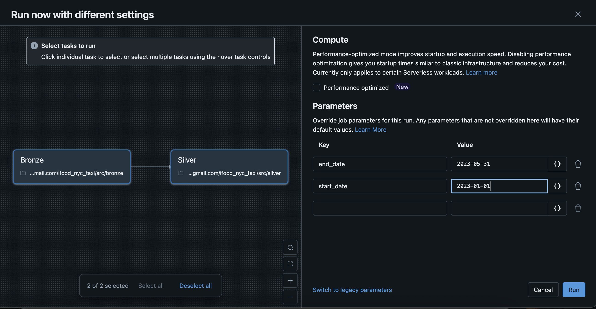

# NYC Taxi Trip Records Pipeline

Este projeto implementa um pipeline de dados para processar registros de corridas de táxi de Nova York, utilizando Databricks Community Edition e Delta Lake. O pipeline é dividido em duas camadas: Bronze e Silver.

## Estrutura do Projeto

```
ifood_nyc_taxi/
├── analysis/
│   ├── perguntas/
│   │    ├──gold.ipynb
│   ├──EDA.ipynb
├── src/
│   ├── bronze.ipynb    # Camada de ingestão e transformação inicial
│   ├── silver.ipynb    # Camada de refinamento e qualidade
│   ├── test_pipeline.py # Testes automatizados
│   └── elt_nyc_taxi.yaml # Configurações do pipeline
└── requirements.txt    # Dependências do projeto
```

## Pré-requisitos

- Conta no Databricks Community Edition (https://community.cloud.databricks.com/)
- Acesso à internet para download dos dados

## Configuração no Databricks Community Edition

1. **Acessar o Databricks Community Edition**:
   - Acesse https://community.cloud.databricks.com/
   - Faça login ou crie uma conta gratuita

2. **Criar um novo Workspace**:
   - Após o login, você terá acesso a um workspace gratuito
   - O Databricks Community Edition já vem com um cluster pré-configurado
   - Não é necessário criar ou configurar clusters adicionais

3. **Importar o Projeto**:
   - No menu lateral, clique em "Workspace"
   - Clique em "New" > "More" > "Git Folder"
   - Na janela de importação, cole a URL do repositório:
     ```
     https://github.com/pedrobragap/ifood_nyc_taxi/
     ```
   - Clique em "Create"
   - O projeto será clonado automaticamente no seu workspace

4. **Configurar o Job**:
   - No menu lateral, clique em "Workflows"
   - Clique em "Create Job"
   - Clique nos três pontos (...) no canto superior direito
   - Selecione "Edit YAML"
   - Cole o seguinte YAML:
   - deve subistituir o email_usuario para o email que criou a conta
     ```resources:
        jobs:
            New_Job_Jun_14_2025_06_35_PM:
            name: New Job Jun 14, 2025, 06:35 PM
            tasks:
                - task_key: bronze
                notebook_task:
                    notebook_path: /Workspace/Users/{email_usuario}/ifood_nyc_taxi/src/bronze
                    source: WORKSPACE
                - task_key: silver
                depends_on:
                    - task_key: bronze
                notebook_task:
                    notebook_path: /Workspace/Users/{email_usuario}/ifood_nyc_taxi/src/silver
                    source: WORKSPACE
            queue:
                enabled: true
            performance_target: STANDARD```

## Como Usar

### 1. Executando o Workflow

Para executar o pipeline de dados:

1. No menu lateral, clique em "Workflows"
2. Localize o job "etl_nyc_taxi"
3. Clique no botão "Run now with different settings"
4. Coloque as datas de incio e fim
    - `"start_date": "2023-01-01"`
    - `"end_date": "2023-05-31"`

5. Aguarde a execução completa
   - O job executará primeiro a camada Bronze
   - Em seguida, executará a camada Silver
   - Você pode acompanhar o progresso em tempo real

### 2. Monitorando a Execução

Durante a execução, você pode:
- Ver o status de cada task (Bronze e Silver)
- Acessar os logs de execução
- Verificar os dados processados nas tabelas:
  - Bronze: `bronze.nyc_taxi_bronze`
  - Silver: `silver.nyc_taxi_silver`

### 3. Executando os Testes

Para executar os testes automatizados:
1. Abra um terminal
2. Execute:
   ```pip install -r requirements.txt
      pytest
   ```
3. Resultado:
    ````
    =================================================== test session starts ===================================================
    platform darwin -- Python 3.9.6, pytest-8.4.0, pluggy-1.6.0 -- /Users/pedrox/ifood_nyc_taxi/venv/bin/python3
    cachedir: .pytest_cache
    rootdir: /Users/pedrox/ifood_nyc_taxi
    collected 4 items                                                                                                         

    test/test_bronze.py::test_month_range_basic PASSED                                                                  [ 25%]
    test/test_bronze.py::test_prepare_df_renames_and_casts PASSED                                                       [ 50%]
    test/test_silver.py::test_prepare_silver_df_filters_and_casts PASSED                                                [ 75%]
    test/test_silver.py::test_prepare_silver_df_empty_when_no_data_in_range PASSED                                      [100%]

    =================================================== 4 passed in 10.18s ====================================================

    ```

## Estrutura dos Dados

### Camada Bronze
- Dados brutos com todas as colunas originais
- Particionado pela dt_partition
- Mantém o histórico completo

### Camada Silver
- Dados refinados com colunas selecionadas
- Filtros de qualidade aplicados:
  - `total_amount > 0`
  - `passenger_count > 0`
  - `tpep_pickup_datetime between(start_date, end_date)`
- Sem duplicatas
- Particionado pela dt_partition

## Colunas Principais

- `vendor_id`: ID do fornecedor
- `passenger_count`: Número de passageiros
- `tpep_pickup_datetime`: Data/hora de início da corrida
- `tpep_dropoff_datetime`: Data/hora de fim da corrida
- `total_amount`: Valor total da corrida
- `taxi_color`: Cor do táxi (yellow/green)
- `dt_partition`: Data de particionamento

## Perguntas e Respostas
   - Qual a média de valor total (**total_amount**) recebido em um mês
considerando todos os yellow táxis da frota?

   ```
      +---------------------+----------------+
      |month(partition_date)|avg_total_amount|
      +---------------------+----------------+
      |                    1|           27.46|
      |                    2|           27.37|
      |                    3|           28.29|
      |                    4|           28.78|
      |                    5|           29.47|
      +---------------------+----------------+
   ```

   - Qual a média de passageiros (passenger_count) por cada hora do dia que pegaram táxi no mês de maio considerando todos os táxis da frota?

   ```
      +-----------+-------------------+
      |hour_of_day|avg_passenger_count|
      +-----------+-------------------+
      |          0|               1.43|
      |          1|               1.44|
      |          2|               1.45|
      |          3|               1.45|
      |          4|               1.40|
      |          5|               1.29|
      |          6|               1.26|
      |          7|               1.28|
      |          8|               1.29|
      |          9|               1.31|
      |         10|               1.35|
      |         11|               1.36|
      |         12|               1.38|
      |         13|               1.38|
      |         14|               1.39|
      |         15|               1.40|
      |         16|               1.40|
      |         17|               1.39|
      |         18|               1.38|
      |         19|               1.39|
      |         20|               1.40|
      |         21|               1.42|
      |         22|               1.43|
      |         23|               1.42|
      +-----------+-------------------+
   ```


